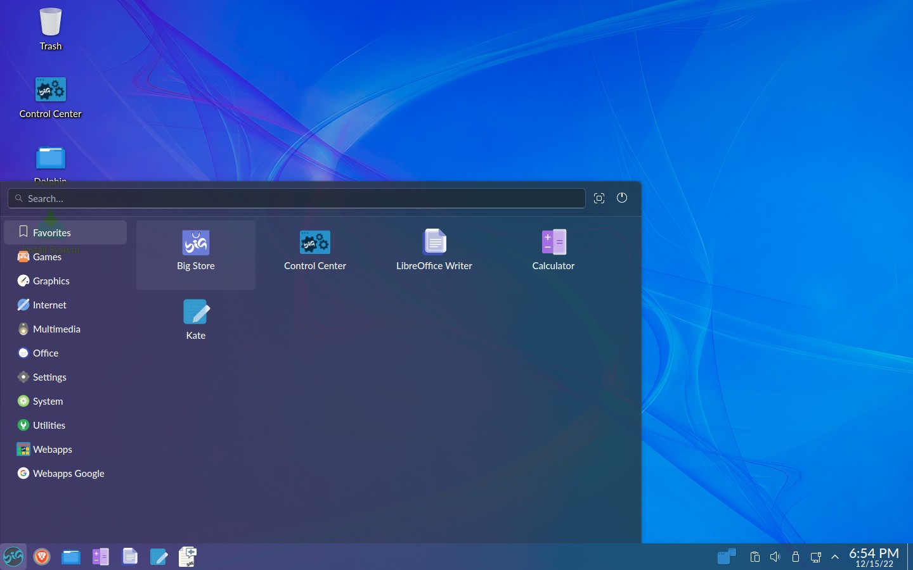

A menu for BigLinux based on the default KDE Plasma menu (Kickoff).

## Relation to upstream Kickoff

The QML in `usr/share/plasma/plasmoids/org.biglinux.appsmenu/contents/` tracks
the Kickoff applet from `plasma-desktop`, currently rebased on the **Plasma 6.7**
branch:

    https://invent.kde.org/plasma/plasma-desktop/-/tree/Plasma/6.7/applets/kickoff

Every BigLinux-specific change on top of that base is marked with a
`// BigLinux:` comment, so a future rebase only has to re-apply those spots:

| File | BigLinux change |
| --- | --- |
| `main.qml` | 48px panel button, group separators always on, leave buttons as focus-chain boundary instead of the pin button |
| `Header.qml` | avatar + search + leave buttons in the header; hovering the avatar shows `user@host`; overflow menu stays icon-only |
| `Footer.qml` | hidden — its tab bar and buttons live in the header |
| `LeaveButtons.qml` | `iconOnlyOverflowMenu` property used by the header |
| `KickoffGridView.qml` | wider cells (1.8×), no side margins, two-cell default width |
| `KickoffListDelegate.qml` | symbolic/colour icon switch, small category icons, taller category rows |
| `KickoffListView.qml` | plain letter section headings, without the separator line |
| `ApplicationsPage.qml` | "All Applications" entry hidden unless enabled, keyboard navigation skips it |
| `BasePage.qml` | no vertical rule between sidebar and content |
| `ConfigGeneral.qml`, `config/main.xml` | `useSymbolicIcons` and `showAllApplications` options; BigLinux defaults (grid view, hover to switch category, app name only, no "New!" badges, `big-favicon-new` icon) |

When rebasing, copy the upstream files over and re-apply the rows above.
